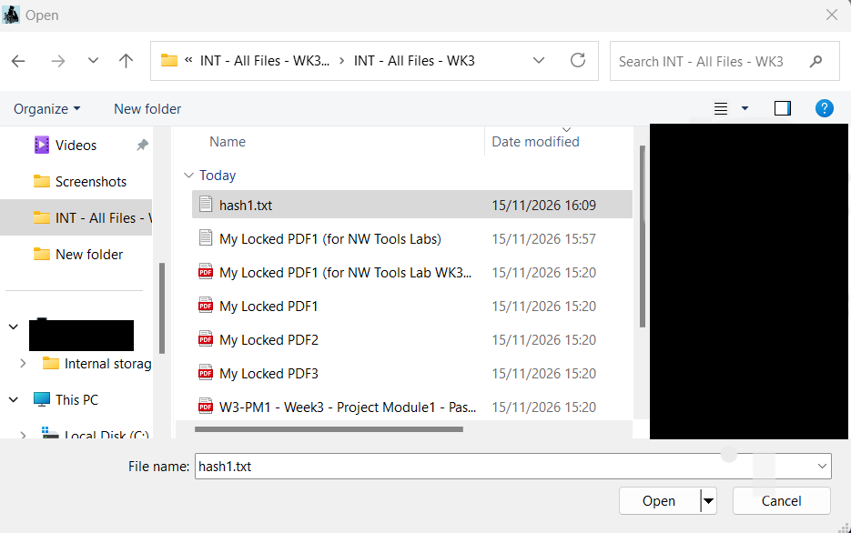
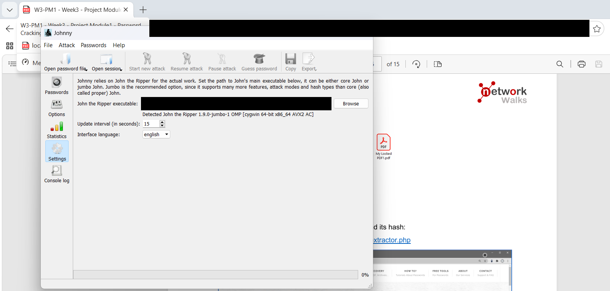
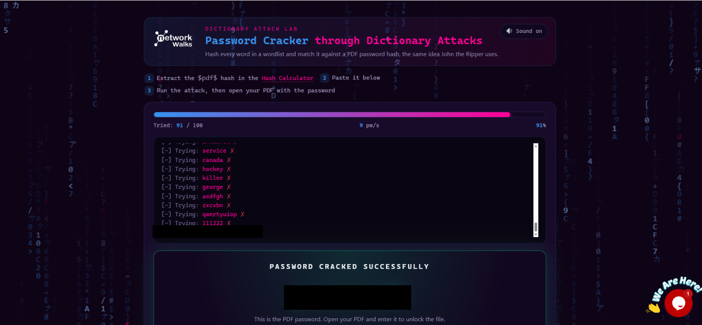
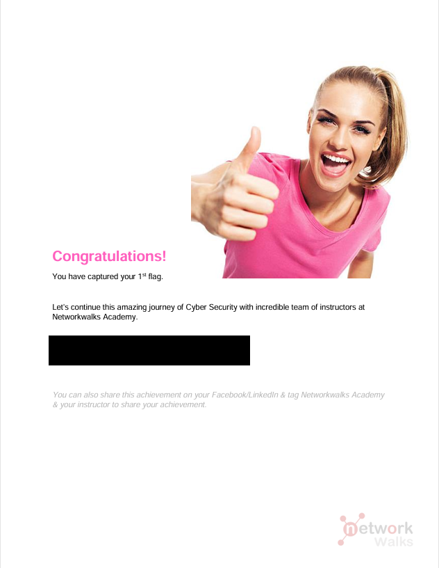
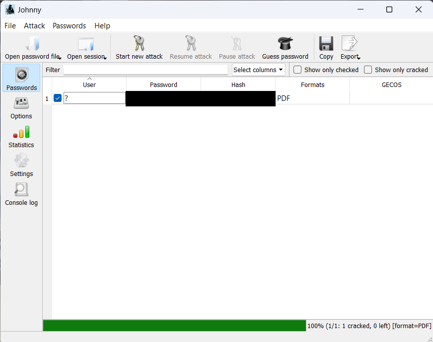
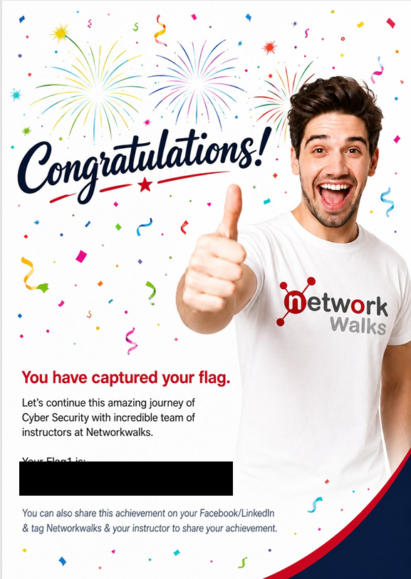

# Evidence

The images below are sanitized copies of the supplied lab screenshots.
Passwords, hashes, flags, local paths, and device details are covered with
solid redactions. The original attachments were not modified.

## Sanitized screenshots

### Hash file selection

### Johnny configuration

### Dictionary attack result

### Training exercise completion

### Johnny password audit

### Hash exercise completion

## Sharing guidance

Before sharing any future evidence:

1. Review the entire image, including window titles, file paths, sidebars, and
   background applications.
2. Permanently redact passwords, hashes, flags, usernames, and personal or
   machine-specific information. Do not rely on blur or translucent markup.
3. Reopen the exported image and verify that the sensitive content cannot be
   recovered or read.
4. Keep original, unredacted captures private and follow the course's sharing
   guidance.

Do not add recovered credentials, hash dumps, wordlists, or tool output to this
directory.
